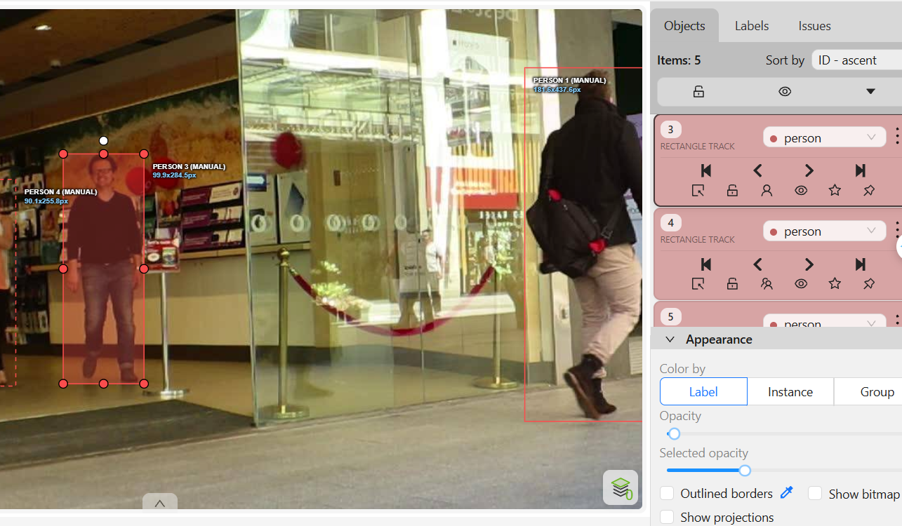
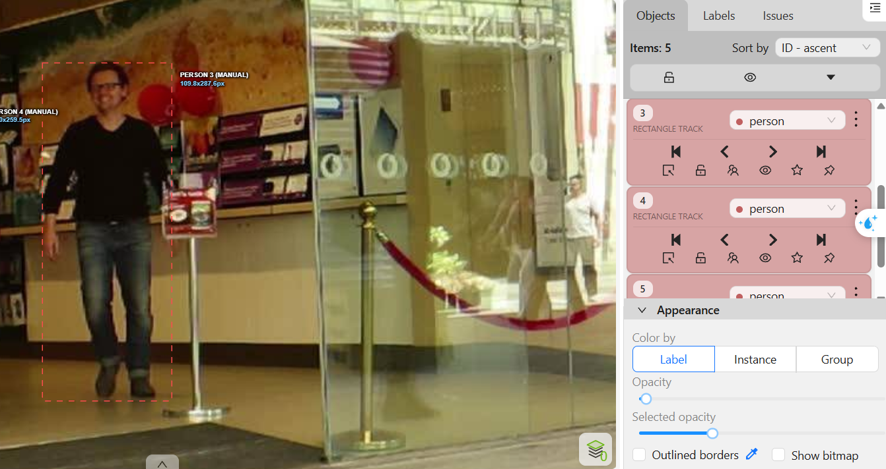
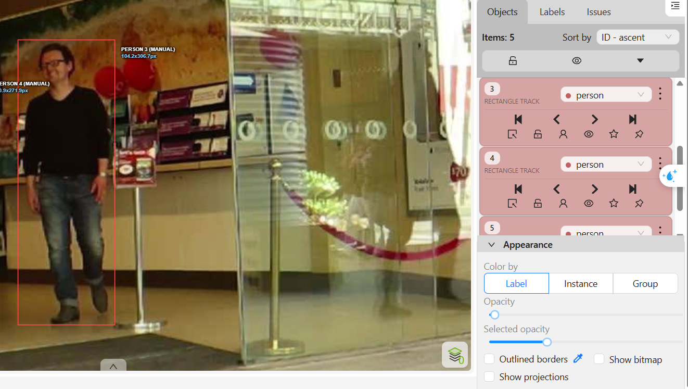

# Báo cáo cá nhân — VuVanLong-2A202603312

> Số liệu lấy từ `src/check_submission.py` và `annotations.xml`. Đề C. Tôi gán nhãn không theo thứ tự P, nên ID trong CVAT không trùng số P. Đối chiếu theo bảng nhận diện: P1 = track CVAT 2 (MOT ID 3), P2 = track 3 (ID 4), P3 = track 1 (ID 2), P4 = track 4 (ID 5), P5 = track 0 (ID 1). Frame tính theo CVAT (bắt đầu từ 0).

Đoạn video: MOT17-09, 150 frame (frame 1–150), nguồn MOTChallenge, giấy phép CC BY-NC-SA 3.0.

## 0. Thông tin học viên

- Họ tên: Vũ Văn Long
- MSSV: 2A202603312
- Mã đề (A/B/C): C
- Email:  26ai.longvv2@vinuni.edu.vn
- Link repository: https://github.com/Long16082004/K5-L2A-DAY05-VuVanLong-2A202603312-MOTTracking
- Giờ bắt đầu: 16h50
- Giờ kết thúc: 18h30

## 1. Xem trước đoạn video (CP0)

Ghi **trước khi vẽ**, mỗi người một dòng.

| Mã | Frame xuất hiện | Frame cuối thấy được | Rẽ / dừng / đổi tốc độ ở frame | Bị che ở frame | Ghi chú |
|---|---|---|---|---|---|
| P1 | 0 | 149 (khuất hẳn 42–43) | Đi chậm trong tiệm Vodafone, gần như đứng lại sau frame 105 | 0–41, 44–54, 98–111 (sau lớp kính) | Nhỏ (box cao ≈ 250–340 px), dễ nhầm với người khác trong tiệm |
| P2 | 39 | 149 | Đi sang phải rồi chậm lại quanh frame 114 | 39–108 | Xuất hiện muộn từ frame 39 |
| P3 | 0 | 149 | Đi chậm lại gần camera sang trái, tăng tốc nhẹ sau frame 105 | 0–66 | Box tăng từ ≈ 410 lên ≈ 840 px, dễ trôi khi lại gần |
| P4 | 0 | 139 (khuất hẳn 107–122) | Đứng yên (x ≈ 1382) từ frame 45 đến 136 | 0 đến hết | Bị che cả đoạn, có đoạn mất hẳn và rời khung từ frame 140 |
| P5 | 0 | 149 (khuất hẳn 137–146) | Đi ngang từ trái sang phải, nhanh ở frame 0–60, chậm dần sau frame 90 | 0–36 và 109–149 | Box to lúc đầu (cao ≈ 690 px ở frame 15) rồi nhỏ dần khi đi xa |

## 2. Keyframe và thời gian (CP1, CP4)

Số keyframe lấy từ kết quả `src/check_submission.py`. Tổng thời gian làm 100 phút (16h50–18h30); thời gian từng người dưới đây là ước lượng chia theo khối lượng keyframe.

| Mã | Số keyframe | Keyframe ở frame | Số frame có mặt | Keyframe / 100 frame | Thời gian (phút) | Chỗ khó |
|---|---|---|---|---|---|---|
| P1 | 34 | 0, 10, 20, 30, 40, 44, 50, 55, 58, 60, 65, 70, 71, 75, 85–91, 93, 95, 98, 101, 104, 105, 112, 114, 115, 125, 135, 145, 149 | 148 | 23.0 | ~15 | Bị che nhiều đoạn sau lớp kính (0–54, 98–111), mất hẳn 2 frame |
| P2 | 12 | 39, 49, 59, 69, 79, 89, 99, 109, 119, 129, 139, 149 | 111 | 10.8 | ~8 | Xuất hiện muộn, bị che 39–108 |
| P3 | 23 | 0, 10, 20, 30, 40, 50, 60, 67, 77, 78, 88, 98, 100, 102, 108, 118, 128, 129, 130, 133, 138, 148, 149 | 150 | 15.3 | ~12 | Box to dần khi lại gần camera |
| P4 | 23 | 0, 10, 20, 30, 40, 50, 100, 123–138 (liên tục) | 124 | 18.5 | ~10 | Đứng yên sau vật che, đoạn mất hẳn và hiện lại |
| P5 | 117 | 0, 3–10, 12–14, 16, 18, 20, 23, 27–31, 33, 36–38, 40, 41, 43–57, 60–119 (gần như liên tục), 122, 123, 125–136, 147, 149 | 140 | 83.6 | ~40 | Đi nhanh, bị che hai đầu, box trôi nên phải sửa từng frame |
| **Tổng** | 209 | | 673 | 31.1 | ~85 (còn ~15 phút xem trước, review, xuất file) | |

Keyframe / 100 frame của cả bài = 209 ÷ 673 × 100 = 31.1

Bạn đặt keyframe nhiều nhất ở người nào? Vì sao (người đó rẽ, dừng, lại gần camera hay bị che)?

Nhiều nhất ở P5 (117 keyframe, 83.6 / 100 frame), vượt ngưỡng cảnh báo 50. P5 vừa đi ngang khung hình nhanh vừa đổi kích thước (to rồi nhỏ dần), lại bị che ở hai đầu đoạn (0–36 và 109–149), nên nội suy giữa hai keyframe cách xa bị lệch box. Tôi đã đặt dày hơn mức cần thiết; nếu làm lại tôi sẽ đặt thưa hơn ở đoạn đi thẳng 60–119 và chỉ dày ở chỗ bị che.

## 3. Đoạn bị che (CP2)

Người bị che: `P1` (người áo đen trong tiệm Vodafone, track CVAT 2)

| Mốc | Frame |
|---|---:|
| Bắt đầu bị che một phần (bật `occluded`) | 0 (bị che từ frame đầu, đến 41) |
| Mất hẳn (bật `outside`) | 42 |
| Hiện lại (tắt `outside`) | 44 |
| Thấy rõ trở lại (tắt `occluded`) | 55 |

- Thời gian khuất hẳn: 2 frame (42–43) = 0.07 giây (MOT17-09 chạy 30 fps).
- Quyết định: giữ cùng ID.
- Lý do (trả lời 3 câu: khuất bao lâu so với 60 frame, ngoại hình có khớp, chỗ hiện lại có đúng hướng và tốc độ):

Khuất hẳn chỉ 2 frame, rất ngắn so với ngưỡng 60 frame nên chắc chắn là cùng một người. Trước và sau đoạn mất đều là người áo đen, quần jean, đeo kính nên ngoại hình khớp. Người này đi chậm trong tiệm, nên chỗ hiện lại (frame 44) gần đúng vị trí cũ và đúng hướng, tốc độ.

Ảnh chụp màn hình:





## 4. Tự review ID (CP3)

Lượt 1 theo người (đi ngược từ frame 149 về 0 trên CVAT), lượt 2 theo cảnh (nhảy 10 frame).

| Frame | Mã người | Loại lỗi | Mô tả một câu | Phát hiện ở lượt | Đã sửa? |
|---:|---|---|---|---|---|
| 46 | P5 | `drift` | Hộp của P5 bị lệch khỏi người sau khi nội suy giữa hai keyframe | 1 (theo người) | Đã sửa |
| 68 | P3 | `flag` | Đánh nhầm cờ (`occluded` / `outside`) cho P3 | 1 (theo người) | Đã sửa |
| 114 | P4 | `flag` | Đánh nhầm cờ (`occluded` / `outside`) cho P4 | 1 (theo người) | Đã sửa |

Tổng hợp số lỗi theo loại:

| `id_switch` | `fragmentation` | `lost` | `merge` | `false_track` | `drift` | `flag` |
|---:|---:|---:|---:|---:|---:|---:|
| 0 | 0 | 0 | 0 | 0 | 1 | 2 |

Lỗi nào chỉ lượt 2 (theo cảnh) mới thấy, lượt 1 (theo người) không thấy? Vì sao?

Cả 3 lỗi đều là lỗi của riêng từng người (hộp lệch, cờ sai), nên lượt 1 đã thấy. Lỗi chỉ lượt 2 mới thấy thường là hai người đi sát nhau bị đổi ID (`id_switch`) hoặc `merge`, vì lượt theo người chỉ nhìn một track nên không so ID giữa người này với người kia. Trong job này không có lỗi loại đó.

## 5. File xuất và kết quả tự kiểm (CP4)

| Kiểm tra | Kết quả |
|---|---|
| Tên file MOT 1.1 | `VuVanLong_mot.zip` |
| Tên file CVAT for video 1.1 | `VuVanLong_cvat_video.zip` |
| Số track ID khác nhau trong `gt/gt.txt` (phải là 5) | 5 (tổng 673 box) |
| Frame `outside` không có dòng trong `gt.txt` (đúng / sai) | Đúng: các đoạn vắng 137–146 (ID 1), 42–43 (ID 3) và 107–122 (ID 4) không có dòng |
| Job đã completed trên CVAT máy cá nhân | Đã completed |

Kết quả in ra từ `src/check_submission.py` (rút gọn danh sách keyframe, xem bảng mục 2):

```text
=== File MOT 1.1: VuVanLong_mot.zip ===
  Số track ID: 5   |   Tổng số box: 673
  [OK]        Đúng 5 track ID.

  Track | Frame có mặt | Số frame | Đoạn vắng (outside)
      1 |   0–149      |      140 | 137–146
      2 |   0–149      |      150 | -
      3 |   0–149      |      148 | 42–43
      4 |   0–139      |      124 | 107–122
      5 |  39–149      |      111 | -

=== File CVAT for video 1.1: VuVanLong_cvat_video.zip ===
  Track | Nhãn   | Frame thấy | Keyframe | KF/100 frame | Frame occluded | Lần bật outside
      0 | person |        140 |      117 |         83.6 |             68 |               1
      1 | person |        150 |       23 |         15.3 |             67 |               0
      2 | person |        148 |       34 |         23.0 |             67 |               1
      3 | person |        111 |       12 |         10.8 |             70 |               0
      4 | person |        124 |       23 |         18.5 |            124 |               2
  Tổng: 209 keyframe / 673 frame có mặt = 31.1 keyframe / 100 frame
  [OK]        Đọc được 5 track từ annotations.xml.
  [CẢNH BÁO]  Track 0: 84 keyframe / 100 frame > 50.

  Lỗi: 0   |   Cảnh báo: 1
```

Cảnh báo duy nhất là keyframe dày ở track 0 (P5): P5 đi ngang khung hình nhanh, bị che ở hai đầu nên nội suy trôi, tôi phải đặt keyframe gần như từng frame ở giữa đoạn. Track 4 (P4) bật `occluded` suốt vì người này đứng yên sau vật che; 2 lần `outside` là đoạn 107–122 và đoạn cuối từ frame 140 (người rời khung, không có dòng trong `gt.txt`).

## 6. Ba câu kết

1. Nếu được gán lại, bạn sẽ đặt keyframe khác ở đâu? Vì sao?

   Với P5, tôi sẽ đặt thưa hơn (khoảng mỗi 10 frame) ở đoạn đi thẳng 60–119 và chỉ đặt dày ở đoạn đổi kích thước hoặc bị che (0–36, 109–149). Với P4 đứng yên, chỉ cần keyframe ở đầu, cuối đoạn đứng yên và hai mép đoạn `outside`. Như vậy giảm từ 31 xuống dưới 20 keyframe / 100 frame mà box vẫn khớp.

2. Có chỗ nào bạn không chắc "cùng ID hay ID mới"? Bạn đã quyết định và ghi chú thế nào?

   Đoạn P1 mất hẳn 42–43 là chỗ tôi cân nhắc nhất. Tôi giữ cùng ID vì khuất chỉ 2 frame, người đi chậm và ngoại hình không đổi. Tôi ghi lại mốc `outside` (42) và hiện lại (44) bằng keyframe ở frame 44 để ai xem sau cũng thấy chỗ nối ID.

3. Một lỗi ID trong job của bạn (nếu không còn sót, chọn lỗi đã sửa) có thể làm xe tự lái dự đoán sai chuyển động của người đó như thế nào? Lỗi đó ảnh hưởng MOTA hay IDF1 nhiều hơn?

   Job của tôi không còn lỗi ID sau khi sửa (không có `id_switch`). Lỗi ở mục 4 chỉ là hộp lệch và cờ sai. Giả sử nếu tôi tạo ID mới cho P1 sau đoạn khuất 42–43, xe sẽ coi đó là người mới xuất hiện đột ngột, mất lịch sử hướng đi và tốc độ nên có thể dự đoán sai hoặc phanh muộn. Lỗi này ảnh hưởng IDF1 nhiều hơn MOTA: MOTA chỉ tính thêm một lần đổi ID, còn IDF1 mất cả đoạn track dài sau đó vì ID không khớp ground truth.

## Bonus (nếu làm)

Không làm bonus.

## 7. Tài liệu tham khảo và công cụ AI đã dùng

- Tài liệu trong repo: `docs/GUIDELINE.md`, `docs/CVAT_CHEATSHEET.md`, `docs/MOT_FORMAT.md`.
- Dữ liệu MOT17-09 từ MOTChallenge (CC BY-NC-SA 3.0).
- Công cụ AI: Claude Code, dùng để chạy `src/check_submission.py`, đọc `annotations.xml` lấy số liệu và soạn nháp báo cáo; tôi tự kiểm tra lại trên CVAT.
